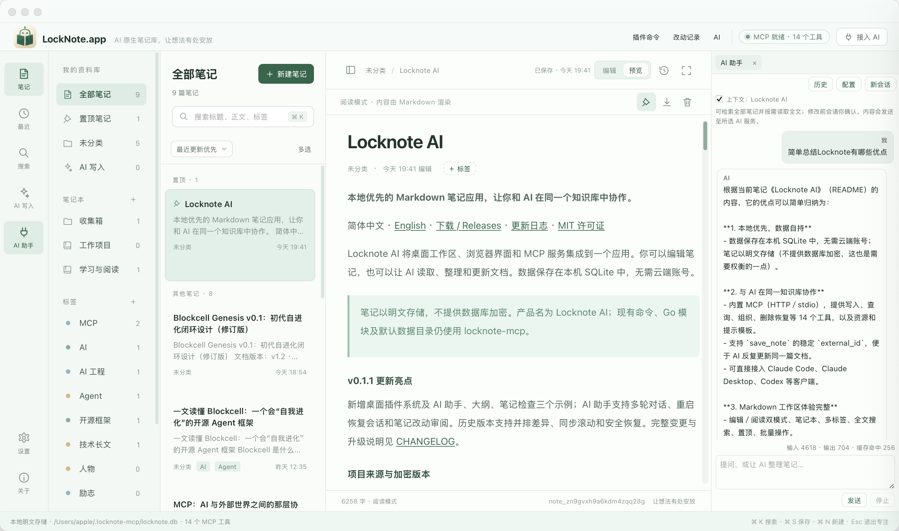

# Locknote AI

**A local-first Markdown notes app where you and AI share one knowledge base.**

[简体中文](README.md) · English · [Downloads / Releases](https://github.com/JackyZhang8/locknote-ai/releases) · [Changelog](CHANGELOG.md) · [MIT License](LICENSE)

Locknote AI combines a desktop workspace, browser interface, and MCP server in one application. Edit notes yourself or let AI read, organize, and update documents. Data stays in a local SQLite database; no cloud account is required.

> Notes are stored in plaintext without database encryption. The product is called Locknote AI; existing commands, the Go module, and the default data directory still use locknote-mcp.

## What’s New in v0.1.1

A desktop plugin system with AI Assistant, Outline, and Note Checker examples. The assistant supports multi-turn chat, session recovery after restart, and reviewable note edits. History now offers side-by-side diffs, synchronized scrolling, and revision-safe restoration. See the [changelog](CHANGELOG.md) for details and upgrade notes.

## Origins and the Encrypted Edition

Locknote AI is based on [Locknote, the encrypted edition](https://github.com/JackyZhang8/locknote). The original Locknote is an encrypted notes app for users who prioritize privacy and data protection and want to store their personal notes with encryption.

This edition focuses on AI collaboration, with an integrated MCP server that lets AI read, organize, and update local notes. It stores data in plaintext SQLite. If encrypted note storage is your priority, take a look at [the encrypted Locknote edition](https://github.com/JackyZhang8/locknote).

## Features

- **Markdown workspace**: editing and reading modes, notebooks, multiple tags, full-text search, pinned notes, and batch actions.
- **Diagram previews**: SVG, Mermaid, and flowchart with source/preview switching. Mermaid is bundled locally for offline use.
- **AI integration**: MCP over HTTP or stdio, 14 tools, resources, and prompt templates. The activity list only shows MCP tool operations.
- **Version recovery**: up to 20 historical versions, side-by-side comparisons between revisions, colored changes, synchronized scrolling, and change navigation. Restoration requires confirmation and revision checks. Empty placeholder notes do not generate history; consecutive UI edits within 30 seconds share a recovery point.
- **Import and export**: Markdown and ZIP, drag-and-drop import, and options to skip, replace, or keep duplicate notes.
- **Trash**: deletion confirmation, a short undo window, and cancellable cleanup with progress and a separate transaction per note. Permanent deletion cannot be undone.
- **Desktop controls**: remembered window state, resizable panes, title-bar double-click to maximize/restore, and save checks before closing.
- **Personalization**: five color palettes, Chinese and English, default editor mode, and font size.

## Quick Start

Get a package for your platform from [Releases](https://github.com/JackyZhang8/locknote-ai/releases). To run from source, prepare the environment below.

Building from source requires Go 1.24+, Node.js 20+, Wails v2.12.0, and the [desktop build prerequisites for your platform](https://wails.io/docs/gettingstarted/installation). The `dev.sh` script targets macOS.

~~~bash
go install github.com/wailsapp/wails/v2/cmd/wails@v2.12.0
./dev.sh
~~~

| Item | Default |
| --- | --- |
| Browser interface | http://127.0.0.1:7420 |
| MCP endpoint | http://127.0.0.1:7420/mcp |
| Database | ~/.locknote-mcp/locknote.db |
| Global token file | ~/.locknote-mcp/token |

If the port is occupied, the desktop workspace remains available, but the AI endpoint does not start. To use another port:

~~~bash
LOCKNOTE_MCP_ADDR=127.0.0.1:7421 ./dev.sh
~~~

### Release Packages

Release assets use the name `locknote-ai-<version>-<platform>`:

| Platform | File suffixes |
| --- | --- |
| macOS Apple Silicon | `macos-arm64.dmg`, `macos-arm64.app.tar.gz` |
| macOS Intel | `macos-x86_64.dmg`, `macos-x86_64.app.tar.gz` |
| Windows x64 | `windows.exe` (installer), `windows.msi` |
| Linux x64 | `linux.deb`, `linux.AppImage` |

Each release includes `SHA256SUMS`. On macOS, drag the app into Applications. On Windows, the recommended `.exe` installer installs WebView2 when needed; install Microsoft Edge WebView2 Runtime before using the `.msi`. Linux packages target Ubuntu 22.04. The AppImage also requires system GTK 3 and WebKitGTK 4.0 (`libgtk-3-0`, `libwebkit2gtk-4.0-37`); it is not a fully self-contained runtime. Use `--appimage-extract-and-run` to bypass FUSE if needed.

### Build and CLI

~~~bash
npm --prefix frontend ci          # Install locked frontend dependencies
npm --prefix frontend run build   # Generate embedded frontend/dist/ assets
wails build -skipbindings          # Desktop output: build/bin/
go build -o /tmp/locknote-mcp .     # Build the executable
/tmp/locknote-mcp serve            # HTTP/MCP server without a window
/tmp/locknote-mcp stdio            # MCP stdio transport
/tmp/locknote-mcp token -new default # Rotate the global token
~~~

The Wails output name is `locknote-ai`. Use -addr to set the server listening address and -data to select the data directory. The corresponding environment variables are LOCKNOTE_MCP_ADDR and LOCKNOTE_MCP_HOME.

## Connect AI

Open **Connect AI** in the upper-right corner to copy the current endpoint, global token, and client configuration. The panel includes examples for Claude Code, Claude Desktop, Codex, and other clients.

- **HTTP**: keep the desktop app or serve process running and connect the client to /mcp.
- **stdio**: configure the client to launch the executable with stdio. Select the same data directory to share notes.
- **Token**: tokens begin with locknote_. The database stores only a hash; the token file uses 0600 permissions. Rotation immediately invalidates the previous token, so update HTTP client configurations afterward.

Example request:

> Summarize the project architecture in Markdown, save it to the “Work Projects” notebook in Locknote AI, and add “architecture” and “project docs” tags. Reuse the same external_id for future updates.

### MCP Capabilities

| Category | Tools |
| --- | --- |
| Write and edit | save_note, save_notes, update_note, append_to_note, move_note |
| Query | get_note, list_notes, search_notes, workspace_overview |
| Organize | list_notebooks, create_notebook, list_tags |
| Delete and restore | delete_note, restore_note |

save_note supports a stable external_id and an if_exists policy: append (default), replace, or skip. Resources include locknote://notes/{id} and notebook, tag, and recent-note indexes. Available prompt templates are save_project_docs, summarize_notebook, and daily_digest.

## Import, Export, and Backups

Exports preserve the note body and append the title, notebook, and tags in a **dedicated HTML comment at the end of the file**. Import restores this metadata and removes the marker from the body. Files without the marker are treated as ordinary Markdown; front matter is not interpreted.

Import Markdown or ZIP from **Settings → Data & Backup**, or drag files into the window. ZIP files do not need extraction. Duplicates are identified by title and notebook; the default is to skip them, with options to replace or keep both. Replacement skips notes whose body is unchanged.

Full exports use a dedicated read-only snapshot and a bounded queue to compress batches directly into ZIP, without intermediate Markdown files or loading all note bodies into memory. Editing can continue during export; cancellation stops further reads. The browser still buffers the compressed ZIP before saving.

Markdown backups do not include empty notebooks, unused tags, version history, preferences, or tokens. Database backups preserve database contents, but exclude plugin files, plugin settings, and AI conversations; back up `plugins/` in the data directory separately. Pending plugin suggestions are stored in local WebView storage and are also excluded from database backups.

### Database Backup

A running SQLite database may have WAL files, so copying only the database file can produce an incomplete backup. Use SQLite's online backup command. Open a terminal:

~~~bash
sqlite3 ~/.locknote-mcp/locknote.db
~~~

Then run these commands, replacing the destination with your backup path:

~~~text
.backup /absolute/path/to/locknote-ai.db
.quit
~~~

Quit the app before restoring and retain a backup of the current database. Database backups and exported notes may contain sensitive information.

## Usage Tips

- Use ⌘/Ctrl + K to search, ⌘/Ctrl + S to save, and ⌘/Ctrl + N to create a note.
- In search, use ↑ / ↓ to select, Enter to open, and Esc to clear and exit.
- Use **＋ Tags** below the title to select or create tags; × removes an association.
- Automatic cleanup only applies to untouched default blank drafts created during the current session, without tags or a pin.

## Plugins

The desktop app supports ZIP installation, enable/disable, settings, logs, and removal under **Settings → Plugins**. Plugins can add sidebars, workspace tabs, bottom panels, commands, menus, and editor actions. Install only trusted plugins: same-page code may read notes and access the network; capability declarations are not a security sandbox. Browser sessions do not load plugins.

The **Plugin market** reads the official static catalog with search, pagination, and compatible release selection. Download packages and confirm installation or upgrades in the app; downloads can be cancelled. Package size, SHA-256, and manifest metadata are verified before installation. The last catalog remains available offline. Plugins never upgrade or activate automatically.

Installation distinguishes upgrades, replacements, and downgrades for the same plugin ID and asks for confirmation. Enabled plugin entries return after restart, and plugins can follow the application language.

| Example | Purpose |
| --- | --- |
| [AI Assistant](examples/plugins/ai-assistant/README.md) | Right-side chat, provider settings, note search, and edit review |
| [Outline](examples/plugins/outline/README.md) | Heading navigation, level filtering, and line navigation |
| [Note Checker](examples/plugins/note-checker/README.md) | Background checks, a bottom panel, and revision-safe cleanup |

Install official examples from the plugin market, or build their ZIPs using the commands in their documentation. See the [plugin developer guide (Chinese)](docs/plugin-development.md) and [TypeScript SDK](sdk/plugin-api/README.md) for packaging, API contracts, and safe startup.

### AI Assistant

After installation and activation, configure an OpenAI-compatible provider, API key, and model in the right panel. The default model is `deepseek-flash`; connection testing and model discovery are available. The assistant uses the current note as context and can search and read other notes in chunks. Multi-turn conversations are saved locally as JSONL; restarting restores the latest session so you can continue chatting.

Proposed edits open in the host diff view, where you can edit, apply, discard, or retain them for later. Notes are written only after successful application. Applying and undoing changes check revisions to protect later edits. A retained suggestion is not a saved note.

Relevant notes and messages are sent to your configured provider. API keys and conversations are stored locally in plaintext; protect and back them up as needed. See [history comparison (Chinese)](docs/history-comparison.md) for detailed comparison controls.

## Development

~~~bash
./dev.sh
npm --prefix frontend run build
npm --prefix frontend test
go test ./...
go vet ./...
wails build -skipbindings
~~~

The frontend uses React 18, TypeScript 5, Vite 5, and Tailwind CSS 3. The backend uses Go, Wails, and SQLite. Vite provides hot reload during development. Production assets under frontend/dist/ are embedded in the Go executable through go:embed, so build the frontend before the first Go test or build. Browser clients receive changes through SSE; the desktop app uses Wails events.

| Path | Responsibility |
| --- | --- |
| main.go / gui.go | CLI, window, and service startup |
| internal/store/ | SQLite, notes, notebooks, tags, history, and indexes |
| internal/api/ | REST, import/export, and events |
| internal/mcp/ | MCP tools, resources, prompts, and transports |
| internal/plugins/ | Plugin installation, state, provider requests, and conversations |
| frontend/src/plugins/ | Plugin runtime, views, and change review |
| sdk/plugin-api/ | TypeScript SDK types and API documentation |
| examples/plugins/ | Three buildable plugin examples |
| tools/plugin-pack/ | Plugin ZIP packaging tool |
| internal/textutil/ | Markdown text helpers |
| frontend/src/ | React UI, styles, business controllers, and diagram previews |
| frontend/public/ | Icons and offline Mermaid dependencies |
| frontend/dist/ | Vite output embedded by Go |
| tests/ | Frontend regression tests |
| build/ | Desktop resources and build output |

Read [AGENTS.md](AGENTS.md) before contributing. Mermaid and dependency licenses are listed in [LICENSES.txt](frontend/public/vendor/mermaid/LICENSES.txt).

## Security Boundaries

The server listens on loopback by default. MCP HTTP requires a Bearer token; REST API requests also require a token when listening on a non-loopback address. Do not expose the plaintext HTTP service directly to the public internet or commit databases, tokens, or private notes to the repository.

## Version Management

Maintain the application version only in the root `VERSION` file. The frontend build synchronizes Wails packaging metadata; the UI, CLI, and MCP share this version. Run `npm --prefix frontend run build` before invoking `wails build` directly. Release tags must match `VERSION` (`v0.1.1` for this release).

## License

This project is licensed under the [MIT License](LICENSE), allowing use, modification, and distribution, including commercial use, provided the copyright and license notices are retained. The software is provided without warranty.

Third-party dependencies retain their own licenses. Notices for the bundled Mermaid distribution and its dependencies are included in [LICENSES.txt](frontend/public/vendor/mermaid/LICENSES.txt).
