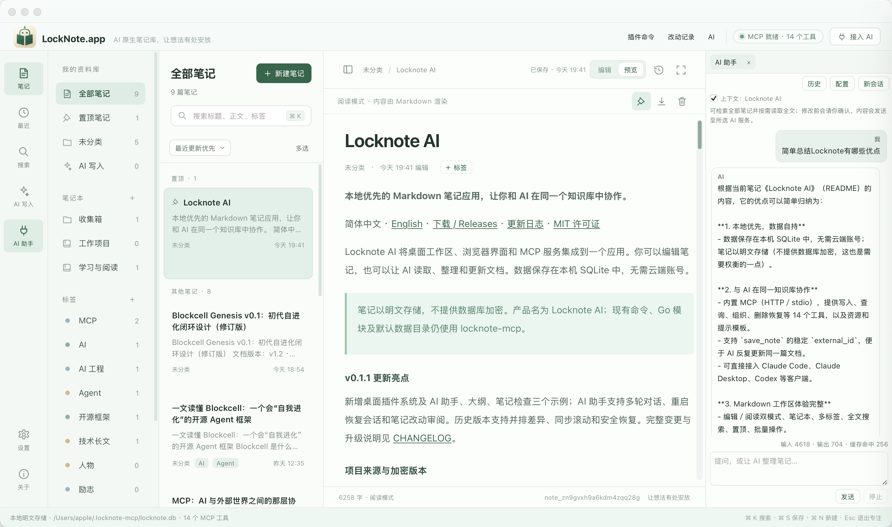

# Locknote AI

**本地优先的 Markdown 笔记应用，让你和 AI 在同一个知识库中协作。**

简体中文 · [English](README.en.md) · [下载 / Releases](https://github.com/JackyZhang8/locknote-ai/releases) · [更新日志](CHANGELOG.md) · [MIT 许可证](LICENSE)

Locknote AI 将桌面工作区、浏览器界面和 MCP 服务集成到一个应用。你可以编辑笔记，也可以让 AI 读取、整理和更新文档。数据保存在本机 SQLite 中，无需云端账号。

> 笔记以明文存储，不提供数据库加密。产品名和主程序名统一为 Locknote AI / locknote-ai；Go 模块、默认数据目录和 LOCKNOTE_MCP_* 环境变量保留原命名。

## v0.1.2 更新亮点

本次重点完善 Windows 安装与启动：统一主程序名为 `locknote-ai.exe`，补齐 MSI 安装向导和 WebView2 检测；正常启动不再全量检查 FTS，增加带备份的数据库维护命令。历史对比和插件管理按需加载，并提供启动诊断日志。AI 助手 0.4.5 新增会话自动命名和更简洁的历史列表。完整变更与升级说明见 [CHANGELOG](CHANGELOG.md) 和 [v0.1.2 发布说明](docs/releases/v0.1.2.md)。

## 项目来源与加密版本

Locknote AI 基于 [Locknote 加密版本](https://github.com/JackyZhang8/locknote) 开发。原版 Locknote 是面向注重隐私与数据保护场景的加密笔记应用，适合希望加密保存个人笔记的用户。

本版本侧重与 AI 协作，集成 MCP 服务，方便 AI 读取、整理和更新本地笔记，数据以明文 SQLite 存储。如果你更看重笔记的加密保护，可了解 [Locknote 加密版本](https://github.com/JackyZhang8/locknote)。

## 功能

- **Markdown 工作区**：编辑与阅读模式、笔记本、多标签、全文搜索、置顶和批量操作。
- **图形预览**：SVG、Mermaid、flowchart，支持源码／预览切换；Mermaid 本地打包，离线可用。
- **AI 协作**：内置 MCP HTTP／stdio、14 个工具、资源和提示模板，活动列表仅显示 MCP 工具操作。
- **历史恢复**：最近 20 个历史版本，支持任意版本并排对比、增删配色、同步滚动与差异定位，恢复前确认并校验版本。空白占位笔记不生成历史，30 秒内连续界面编辑合并恢复点。
- **导入导出**：Markdown 和 ZIP，支持拖拽导入；重复笔记可跳过、覆盖或保留两份。
- **回收站**：删除确认、短时撤销、逐篇事务清空、进度与取消。永久删除不可撤销。
- **桌面体验**：窗口状态记忆、可调分栏、顶部栏双击最大化／还原、关闭前保存检查。
- **个性化**：五种配色、中英文、默认编辑模式与字号。

## 快速开始

从 [Releases](https://github.com/JackyZhang8/locknote-ai/releases) 获取对应平台的安装包；如需从源码运行，请按以下步骤准备环境。

源码构建需要 Go 1.24+、Node.js 20+、Wails v2.12.0 以及[平台对应的桌面编译环境](https://wails.io/docs/gettingstarted/installation)。`dev.sh` 面向 macOS。

~~~bash
go install github.com/wailsapp/wails/v2/cmd/wails@v2.12.0
./dev.sh
~~~

| 项目 | 默认值 |
| --- | --- |
| 浏览器界面 | http://127.0.0.1:7420 |
| MCP 端点 | http://127.0.0.1:7420/mcp |
| 数据库 | ~/.locknote-mcp/locknote.db |
| 全局令牌文件 | ~/.locknote-mcp/token |

端口占用时桌面仍可使用，但 AI 端点不会启动。更换端口：

~~~bash
LOCKNOTE_MCP_ADDR=127.0.0.1:7421 ./dev.sh
~~~

### 发布安装包

GitHub Release 文件统一以 `locknote-ai-<版本号>-<平台>` 命名：

| 平台 | 文件后缀 |
| --- | --- |
| macOS Apple Silicon | `macos-arm64.dmg`、`macos-arm64.app.tar.gz` |
| macOS Intel | `macos-x86_64.dmg`、`macos-x86_64.app.tar.gz` |
| Windows x64 | `windows-x64.exe`（安装程序）、`windows-x64.msi` |
| Linux x64 | `linux.deb`、`linux.AppImage` |

发布页同时提供 `SHA256SUMS` 校验文件。macOS 将应用拖入 Applications 即可安装。Windows 的 `.exe` 和 `.msi` 均需要预先安装 Microsoft Edge WebView2 Evergreen Runtime；缺失时安装器会提示并退出，离线环境请先安装微软提供的 Evergreen Standalone Installer x64。安装后主程序统一为 `locknote-ai.exe`。Linux 面向 Ubuntu 22.04，AppImage 也需要系统提供 GTK 3 和 WebKitGTK 4.0（`libgtk-3-0`、`libwebkit2gtk-4.0-37`），不是完全独立的运行环境；必要时可通过 `--appimage-extract-and-run` 绕过 FUSE。

### 构建与命令行

~~~bash
npm --prefix frontend ci          # 安装锁定的前端依赖
npm --prefix frontend run build   # 生成 Go 嵌入的 frontend/dist/
wails build -skipbindings          # 桌面产物位于 build/bin/
go build -o /tmp/locknote-ai .     # 构建可执行文件
/tmp/locknote-ai serve            # HTTP／MCP 服务，不打开窗口
/tmp/locknote-ai stdio            # MCP stdio 模式
/tmp/locknote-ai token -new 默认  # 更换全局令牌
~~~

Wails 输出名称为 `locknote-ai`。服务用 -addr 指定监听地址，各模式用 -data 指定数据目录。环境变量为 LOCKNOTE_MCP_ADDR 和 LOCKNOTE_MCP_HOME。

## 接入 AI

点击右上角 **接入 AI**，复制当前端点、全局令牌和客户端配置。面板提供 Claude Code、Claude Desktop、Codex 和通用配置示例。

- **HTTP**：保持桌面应用或 serve 进程运行，客户端连接 /mcp。
- **stdio**：客户端启动可执行文件并传入 stdio；指定相同数据目录即可共享笔记。
- **令牌**：前缀为 locknote_，数据库只存哈希，令牌文件权限为 0600。更换后旧令牌立即失效，需要更新 HTTP 客户端配置。

连接后可这样提出任务：

> 将项目架构整理成 Markdown，保存到 Locknote AI 的“工作项目”笔记本，添加“架构”和“项目文档”标签。以后更新时使用相同的 external_id。

### MCP 能力

| 类别 | 工具 |
| --- | --- |
| 写入与编辑 | save_note、save_notes、update_note、append_to_note、move_note |
| 查询 | get_note、list_notes、search_notes、workspace_overview |
| 组织 | list_notebooks、create_notebook、list_tags |
| 删除与恢复 | delete_note、restore_note |

save_note 支持稳定的 external_id；if_exists 可选 append（默认）、replace、skip。资源包括 locknote://notes/{id} 以及笔记本、标签和最近笔记索引。提示模板为 save_project_docs、summarize_notebook、daily_digest。

## 导入、导出与备份

导出保留正文，在**文件末尾的专用 HTML 注释标记**中记录标题、笔记本和标签。导入时还原这些信息，标记不会进入正文。无标记文件按普通 Markdown 处理，不解析 front matter。

在 **设置 → 数据与备份** 中导入 Markdown／ZIP，或直接拖入窗口。ZIP 无需解压。重复笔记按标题和笔记本识别，默认跳过，可选择覆盖或保留两份；覆盖模式下正文相同则跳过。

整库导出使用独立只读快照，分批读取并通过有界队列直接压缩到 ZIP，不生成中间 MD 文件，也不把全部正文读入内存。导出期间可继续编辑；取消会停止后续读取。浏览器保存下载时仍会缓存压缩后的 ZIP。

Markdown 备份不包含空笔记本、未使用标签、历史版本、偏好设置或令牌。数据库备份可保留数据库内的数据，但不包含插件文件、插件配置或 AI 聊天记录；这些文件需另行备份数据目录中的 `plugins/`。待应用的插件建议稿保存在本机 WebView 存储中，也不属于数据库备份。

### 完整数据库备份

运行中的 SQLite 可能有 WAL 文件，单独复制数据库文件不保证完整。使用 SQLite 在线备份，在终端打开：

~~~bash
sqlite3 ~/.locknote-mcp/locknote.db
~~~

再执行以下命令，将路径替换为实际备份位置：

~~~text
.backup /absolute/path/to/locknote-ai.db
.quit
~~~

恢复前退出应用，并保留当前数据库备份。数据库与导出文件都可能包含敏感信息。

## 操作提示

- ⌘/Ctrl + K 搜索，⌘/Ctrl + S 保存，⌘/Ctrl + N 新建。
- 搜索中用 ↑ / ↓ 选择、Enter 打开、Esc 清空并退出。
- 标题下 **＋ 标签** 可选择或创建标签，× 移除关联。
- 自动清理仅针对本次会话新建、从未编辑且无标签、无置顶的默认空白草稿。

## 插件

桌面应用在 **设置 → 插件** 中支持 ZIP 拖入安装、启用、禁用、配置、日志与卸载。插件可扩展左右侧栏、主工作区标签页、底部面板、命令、菜单和编辑器操作。仅安装可信插件：同页面代码可以读取笔记和访问网络，能力声明不构成安全沙箱。浏览器默认不加载插件。

「插件市场」读取官方静态目录，支持搜索、分页和兼容版本筛选，可直接下载并确认安装或升级。下载支持取消；安装前校验包大小、SHA-256 和插件清单。离线时可浏览上次缓存的目录，插件不会自动升级或启用。

同 ID 插件安装时区分升级、替换和降级，并在确认后处理；重启恢复已启用插件的入口。插件支持跟随应用切换中英文。

| 示例 | 用途 |
| --- | --- |
| [AI 助手](examples/plugins/ai-assistant/README.md) | 右侧聊天、Provider 配置、笔记检索与改动审阅 |
| [大纲侧栏](examples/plugins/outline/README.md) | 标题导航、层级筛选与行定位 |
| [笔记检查](examples/plugins/note-checker/README.md) | 后台检查、底部面板及版本安全的格式整理 |

可在插件市场安装官方示例，也可自行打包后拖入安装，命令见各示例文档。插件开发、打包与安全启动见 [插件开发指南](docs/plugin-development.md)，接口类型见 [TypeScript SDK](sdk/plugin-api/README.md)。

### AI 助手

安装并启用后，在右侧面板配置 OpenAI 兼容 Provider、API Key 和模型，默认模型为 `deepseek-flash`；可测试连接并获取模型列表。助手以当前笔记为上下文，按需搜索和分块读取其他笔记，支持多轮对话。聊天按会话保存为本地 JSONL，重启恢复最近会话并可继续对话。

笔记改动先进入宿主差异视图，可编辑、应用或丢弃，也可保留建议稿稍后处理；只有应用成功后才写入笔记。应用与撤回均检查版本，避免覆盖后续编辑。建议稿不是已保存笔记。

调用模型时，相关笔记及聊天内容会发送到你配置的 Provider；API Key 与聊天记录在本机明文保存，请按需备份并保护这些文件。历史版本对比的操作说明见 [历史版本对比](docs/history-comparison.md)。

## 开发

~~~bash
./dev.sh
npm --prefix frontend run build
npm --prefix frontend test
go test ./...
go vet ./...
wails build -skipbindings
~~~

前端采用 React 18、TypeScript 5、Vite 5 和 Tailwind CSS 3，后端使用 Go、Wails 和 SQLite。开发时 Vite 提供热更新；正式构建将 frontend/dist/ 通过 go:embed 嵌入 Go 可执行文件，因此首次运行 Go 测试或构建前需先构建前端。浏览器使用 SSE，桌面使用 Wails 事件接收变更。

| 路径 | 职责 |
| --- | --- |
| main.go / gui.go | CLI、窗口和服务启动 |
| internal/store/ | SQLite、笔记、分类、标签、历史和索引 |
| internal/api/ | REST、导入导出和事件 |
| internal/mcp/ | MCP 工具、资源、提示和传输 |
| internal/plugins/ | 插件安装、状态、Provider 请求及会话存储 |
| frontend/src/plugins/ | 插件运行时、视图与改动审阅 |
| sdk/plugin-api/ | TypeScript SDK 类型与接口说明 |
| examples/plugins/ | 三个可打包的开发示例 |
| tools/plugin-pack/ | 插件 ZIP 打包工具 |
| internal/textutil/ | Markdown 文本辅助处理 |
| frontend/src/ | React 页面、样式、业务控制器及图形预览 |
| frontend/public/ | 图标与离线 Mermaid 依赖 |
| frontend/dist/ | Vite 构建产物，由 Go 嵌入 |
| tests/ | 前端回归测试 |
| build/ | 桌面资源与构建产物 |

贡献前请阅读 [AGENTS.md](AGENTS.md)。Mermaid 及依赖许可见 [LICENSES.txt](frontend/public/vendor/mermaid/LICENSES.txt)。

## 安全边界

默认监听回环地址。MCP HTTP 校验 Bearer 令牌；监听非回环地址时 REST API 也要求令牌。请勿将明文 HTTP 服务直接暴露到公网，勿将数据库、令牌或私人笔记提交到仓库。

## 版本维护

版本号统一在根目录 `VERSION` 中维护。只修改该文件；前端构建会自动同步 `wails.json` 中的打包版本，界面、CLI 和 MCP 使用同一版本。手动运行 `wails build` 前先执行 `npm --prefix frontend run build`，发布标签必须与 `VERSION` 一致（本版本为 `v0.1.2`）。

## 许可证

本项目采用 [MIT License](LICENSE)，允许使用、修改和分发，包括商业用途；分发时须保留版权和许可声明。软件按原样提供，不附带担保。

第三方依赖遵循各自的许可证。随应用分发的 Mermaid 及其依赖声明见 [LICENSES.txt](frontend/public/vendor/mermaid/LICENSES.txt)。
